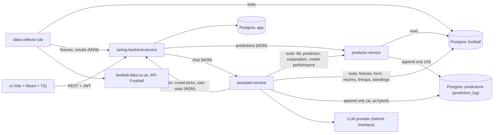
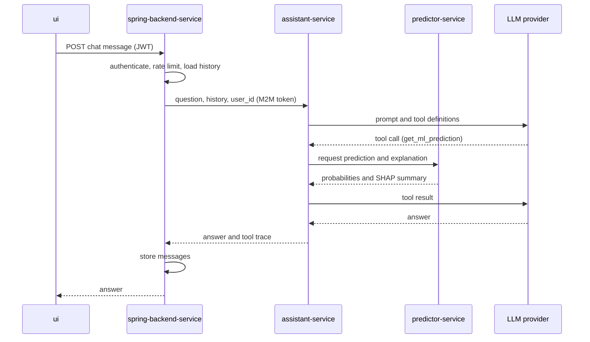

# Architecture

> This document is subject to change. It describes system architecture and the decisions behind it. Implementation order and tasks are in [development-plan.md](development-plan.md). Sections marked as _(TO BE DETAILED)_ will be made but their architecture details are not yet known and sections marked as _(TO BE DECIDED)_ are waiting for a decision whether they are even going to be made.

## 1. Overview

The thesis research base is ML vs AI predictions: comparing prediction models, evaluating them live on matches they have not seen and evaluating the assistant. The architecture is therefore built around one rule: **ML predictions come only from `predictor-service`. The assistant explains, looks up data and makes its own predictions, which are saved separately so both can be compared on the same matches.**

Scope: English Premier League only.

## 2. Components

| Component                | Responsibility                                                                                           | Tech                    | Owns (writes)                                                               |
| ------------------------ | -------------------------------------------------------------------------------------------------------- | ----------------------- | --------------------------------------------------------------------------- |
| `ui`                     | Screens: login, leagues, round predictions, leaderboard, chat                                            | Vite, React, TypeScript | nothing                                                                     |
| `spring-backend-service` | The game: users, leagues, invitations, predictions, scoring, chat history. The only entry point for `ui` | Java, Spring Boot       | schema `app`                                                                |
| `predictor-service`      | Features, training, explanations (SHAP), evaluation, saving ML predictions                               | Python, FastAPI         | schema `predictions`, model artifacts                                       |
| `assistant-service`      | One stateless AI agent with tools: answers questions and makes its own predictions                       | Python, FastAPI         | its own rows in `predictions.prediction_log` (`source` = `ai`, `ai-hybrid`) |
| `data-collector`         | Job (not a long-running service): fetches external data and writes it                                    | Python                  | schema `football`                                                           |
| Postgres                 | One server, three schemas: `app`, `football`, `predictions`                                              | PostgreSQL              | -                                                                           |

External systems: [football-data.co.uk](https://www.football-data.co.uk/englandm.php) (historical results, statistics, odds), [API-Football](https://www.api-football.com/) (fixtures, injuries, lineups, player statistics) and an LLM provider.

## 3. System diagram



## 4. Data

### 4.1 Schemas and ownership

Rule: **one writer per schema**, with one exception: `predictions.prediction_log`, where both `predictor-service` and `assistant-service` add predictions. Other services read through the database only where noted, otherwise through an API.

| Schema        | Writer                                                               | Readers                                  | Content                                                |
| ------------- | -------------------------------------------------------------------- | ---------------------------------------- | ------------------------------------------------------ |
| `app`         | `spring-backend-service`                                             | `spring-backend-service`                 | the game state                                         |
| `football`    | `data-collector`                                                     | `predictor-service`, `assistant-service` | external football data, every record with `fetched_at` |
| `predictions` | `predictor-service` (`assistant-service` only into `prediction_log`) | `predictor-service`, `assistant-service` | saved predictions and evaluation results               |

`spring-backend-service` never reads `football` directly. It keeps its own `round` and `match` tables (fixtures, kick-off times, results) that `data-collector` synchronizes through M2M endpoints. The game therefore does not depend on analytics data.

### 4.2 Main entities

- **`app`:** user, league (including the global league), membership, invitation, round, match, prediction, points, chat message.
- **`football`:** team, match, team fixtures across all competitions (for rest days and congestion), injury, lineup, player statistics. Odds are stored for evaluation only.
- **`predictions`:** `prediction_log` and evaluation results.

### 4.3 prediction_log

Append-only record of every prediction made by the ML models and the AI assistant before a match.

| Column                       | Meaning                                                                                        |
| ---------------------------- | ---------------------------------------------------------------------------------------------- |
| `match_id`                   | reference to `football.match`                                                                  |
| `source`                     | who made the prediction: `ml` (`predictor-service`), `ai` or `ai-hybrid` (`assistant-service`) |
| `model_version`              | ML model version, or for AI sources the LLM model name and prompt version                      |
| `snapshot_time`              | when the prediction was made (early snapshot or final, after lineups)                          |
| `p_home`, `p_draw`, `p_away` | W/D/L probabilities                                                                            |
| `most_likely_score`          | the most likely exact score                                                                    |
| `score_matrix`               | exact-score probabilities (ML only, added when scores are modeled)                             |
| `reasoning`                  | short explanation of the prediction (AI only)                                                  |

Immutability is enforced with database permissions: the roles of `predictor-service` and `assistant-service` have only `INSERT` and `SELECT` on this table, so no one can change or delete a prediction after the result is known. Each service writes only its own `source`. This table is what makes the evaluation honest: every model is judged on matches it could not have seen. Because the rows can't be made again, the `predictions` schema is backed up after each round.

### 4.4 Time and leakage

Every injury and lineup record carries `fetched_at`. Features for a match may only use information available before kick-off and training must reconstruct what was known at that time. Validation is chronological (walk-forward), never a random split. Feature code lives in `predictor-service` and is shared by training and inference so both compute features identically.

AI predictions only count in the evaluation for matches played after the LLM's knowledge cutoff, so the LLM can't already know the result.

## 5. Key flows

### 5.1 Weekly cycle

1. A round finishes. The trigger is the completed round, not a fixed 7-day timer.
2. `data-collector` fetches results, fixtures, injuries and statistics, writes them to `football` and sends fixtures and results to `spring-backend-service`.
3. `spring-backend-service` scores the finished round and updates leaderboards.
4. `predictor-service` retrains or refreshes the model if needed and writes an early snapshot for the next round to `prediction_log`.
5. `assistant-service` writes its early snapshot (`ai` and `ai-hybrid`). The hybrid variant runs after step 4 because it uses the ML prediction.
6. After lineups are confirmed (about one hour before kick-off), `data-collector` fetches them and both `predictor-service` and `assistant-service` write their final snapshots.

### 5.2 Making predictions

`ui` asks `spring-backend-service` for a round. `spring-backend-service` returns the matches, the most common predictions of other users, the ML suggestion and the assistant's prediction. The last two are read from `prediction_log` through `predictor-service`, with a timeout and a fallback. Predictions lock at kick-off.

### 5.3 Chat



Until `spring-backend-service` exists (phase 5), `assistant-service` is called directly and has no user tools.

Assistant tools (full list in [development-plan.md](development-plan.md), section 4.4):

| Tools                                                                                                           | Served by                                                    |
| --------------------------------------------------------------------------------------------------------------- | ------------------------------------------------------------ |
| `get_fixtures`, `get_match`, `get_team_form`, `get_head_to_head`, `get_standings`, `get_injuries`, `get_lineup` | `football` schema (read-only)                                |
| `get_ml_prediction`, `get_ml_explanation`, `get_model_performance`                                              | `predictor-service`                                          |
| `get_crowd_picks`, `get_my_stats`                                                                               | `spring-backend-service` (M2M, only the calling user's data) |

Rules: answers use numbers from the tools and say where they come from (ML model, data or the assistant's own prediction). If a tool returns no data, the assistant says so. Out-of-scope questions (other leagues, betting advice) are declined.

### 5.4 The assistant's own predictions

A scheduled job in `assistant-service` runs at the same times as the ML snapshots (5.1). For each match of the next round it makes two predictions:

- **`ai`** - the assistant only gets the data from the tools, without the ML prediction
- **`ai-hybrid`** - the assistant also sees the ML prediction and its explanation and can change it

The output has the same format as the ML predictions (W/D/L probabilities, the most likely score) plus a short reasoning and is written directly to `prediction_log`. A low temperature and a versioned prompt make the results repeatable.

## 6. Security and trust boundaries

- **`ui` to `spring-backend-service`:** JWT. Two authentication providers (to be chosen, e.g. Google OAuth2 and local login), configured through `SecurityFilterChain`.
- **Service to service:** M2M tokens with a separate identity per service. `spring-backend-service` accepts only what each identity needs (`data-collector`: fixtures and results, `assistant-service`: crowd picks and user stats).
- **`assistant-service` never receives the user's JWT.** It receives only the `user_id` that `spring-backend-service` has already authenticated and its user tools return data for that user only.
- **Database roles:** one role per service, least privilege. Each role writes only its own schema, except `assistant-service`, which can only `INSERT` and `SELECT` on `predictions.prediction_log`. Read access is granted per schema as listed in 4.1.
- **Secrets:** environment variables only. LLM API keys exist only in `assistant-service`, the API-Football key only in `data-collector`.
- **Chat abuse and cost:** per-user rate limiting in `spring-backend-service` protects the LLM quota.

## 7. Reliability

The system is a handful of containers on one Postgres, not a distributed system in the research sense. Failures are handled so the game keeps working.

| Failure                                         | Behavior                                                                                                                  |
| ----------------------------------------------- | ------------------------------------------------------------------------------------------------------------------------- |
| `predictor-service` down                        | ML suggestion hidden, predictions, scoring and leagues keep working. Gaps in `prediction_log` are visible.                |
| `assistant-service` or LLM down or rate-limited | Chat disabled with a clear message, AI snapshots for that time are missing (visible as gaps), everything else unaffected. |
| `data-collector` fails                          | Last known data remains, the job is idempotent and can be re-run. Staleness is visible through `fetched_at`.              |
| API-Football daily quota reached                | Remaining fetches wait for the next day, lineups and fixtures take priority.                                              |
| `spring-backend-service` down                   | `ui` unavailable, `predictor-service`, `assistant-service` and `data-collector` continue independently.                   |
| Database data lost                              | `predictions` is restored from the last per-round backup.                                                                 |

## 8. Repository layout

```
Match Predictor/
  docs/
    assistant-service/
    predictor-service/
    spring-backend-service/
    ui/
    architecture.md
    development-plan.md
  assistant-service/
  data-collector/     # moved here and modified in phase 3
  predictor-service/
    api/
    data_collector/   # moves out in phase 3
    ...
  spring-backend-service/
  ui/
  .gitignore
  docker-compose.yml
  README.md
```

Until phase 3 the `data-collector` code lives inside `predictor-service` as a separate module with no imports from `features/` or `models/`, so it can be moved out without rewriting.

## 9. Deployment

Target: everything in `docker-compose` on a single host. Services: `ui` (static files), `spring-backend-service`, `predictor-service`, `assistant-service`, `data-collector` (runs on a schedule, not always up), `postgres`.

- **Always-on server from phase 2 _(TO BE DECIDED)_:** live predictions start in phase 2, so the scheduler and Postgres have to run on a server that is always up (a free-tier VM or a hosted Postgres like Neon or Supabase), not only on a laptop.
- **Reverse proxy _(TO BE DECIDED)_:** nginx or Caddy can serve the built SPA and forward `/api` to `spring-backend-service`, which gives one origin (no CORS) and one place for TLS. The alternative is free static hosting for the SPA. Decide in phase 7.
- **Hosting _(TO BE DECIDED)_:** a single free-tier VM running the compose stack is the preferred option, check current free-tier terms when the time comes.

## 10. Built to grow

Scaling is not the main part of this project, but nothing in the design blocks it:

- services are stateless and keep state only in the database
- configuration only through environment variables
- `/health` on every service
- idempotent jobs
- `data-collector` doesn't import anything from features or models
- LLM provider behind an interface
- timeouts and fallbacks when calling other services

## 11. Decisions

**D1. Premier League only.** Free API quotas (100 requests a day for API-Football) are comfortable for one league, the dataset stays small enough to focus on research instead of data engineering and single-league studies are common in the literature.

**D2. Bookmaker odds are not features.** Using them as inputs would make the comparison with bookmakers circular. Odds stay in the dataset and are used only in evaluation.

**D3. Chronological validation.** Walk-forward validation, never a random split to avoid leaking the future into training. Features use only data known before kick-off.

**D4. ML and AI predictions are kept separate.** `predictor-service` produces the ML predictions, `assistant-service` gets them through a tool and makes its own predictions in two variants (`ai` without the ML prediction, `ai-hybrid` with it). Both are saved in the same format so they can be compared on the same matches, which is the core of the research.

**D5. Four services, one job, one Postgres.** `ui`, `spring-backend-service`, `predictor-service`, `assistant-service`, plus a `data-collector` job and one database with separate schemas.

**D6. One writer per schema, with one exception.** `app` is written by `spring-backend-service`, `football` by `data-collector`, `predictions` by `predictor-service`. The exception is `predictions.prediction_log`, where `assistant-service` also adds its own predictions directly instead of sending them through `predictor-service`, which would only add another API with nothing gained. Sharing `football` and `predictions` as read-only schemas is a pragmatic compromise not fully backed by microservice architecture, but it is accepted here for simplicity.

**D7. `spring-backend-service` is the only entry point for `ui`.** It owns authentication, game rules, rate limiting and chat history. `assistant-service` and `predictor-service` are internal.

**D8. Stateless assistant.** `spring-backend-service` sends the history and the authenticated `user_id` with each request. `assistant-service` holds no state and no user credentials.

**D9. `spring-backend-service` keeps its own `round` and `match` tables.** They are synchronized from `data-collector` through M2M endpoints, so the game does not depend on analytics data and `football` stays out of its hands.

**D10. `prediction_log` is append-only and lives in its own schema.** This gives honest live evaluation, allows early and final snapshots and lets several prediction sources (`ml`, `ai`, `ai-hybrid`) be compared on identical terms. Database permissions allow only `INSERT` and `SELECT`, so no prediction can be changed after the result is known.

**D11. `data-collector` starts as a module, then becomes a job.** While `predictor-service` is the only consumer, it stays inside it. When `assistant-service` and `spring-backend-service` arrive, it moves to its own folder with its own Dockerfile and writes to `football`.

**D12. Not a research project in distributed systems yet.** One database instance, one host, no replication, sharding or message broker. Resilience is handled with timeouts and fallbacks (section 7).

**D13. Frontend: Vite + React + TypeScript.** There is no need for server-side rendering or SEO and `spring-backend-service` is already the backend, so Next.js would only add a Node layer.

**D14. `assistant-service` is built before `spring-backend-service`.** The research (ML vs AI predictions) is the priority and every round without AI predictions is lost for the live evaluation. Until phase 5 the assistant is called directly and has no user tools.

## 12. Open questions

- Scoring rules (outcome, exact score, goal difference, bonuses)
- Which two authentication providers
- Which 2-3 LLM models to compare (see [development-plan.md](development-plan.md), section 4.2) and whether to use the providers' SDKs or a library that supports many providers
- How the majority of users gets into the evaluation as a prediction source: which service computes it and where it is saved
- Which always-on server to use for live predictions from phase 2
- Mentor's chosen direction: modern models, explainability, or source comparison
- Reverse proxy and hosting (phase 7)
